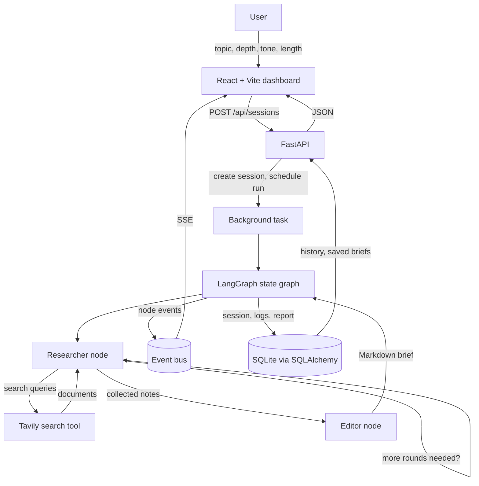
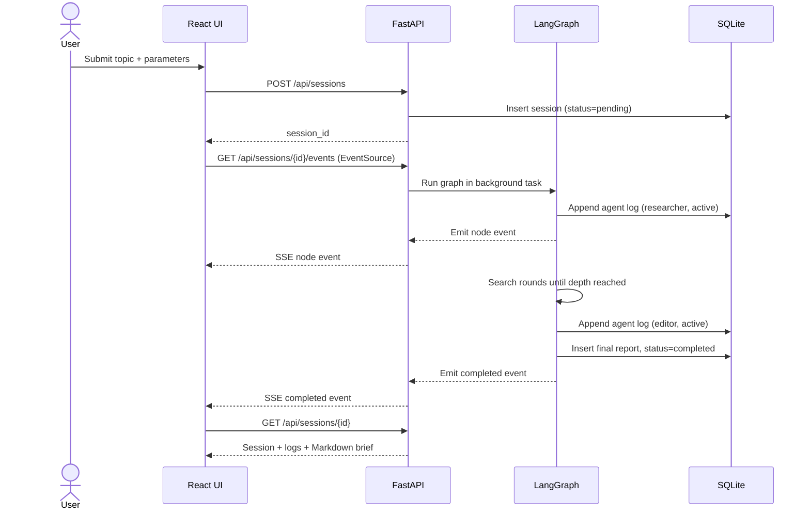
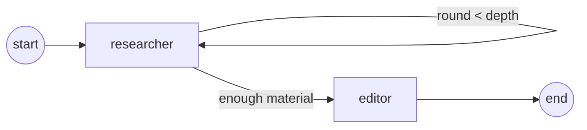
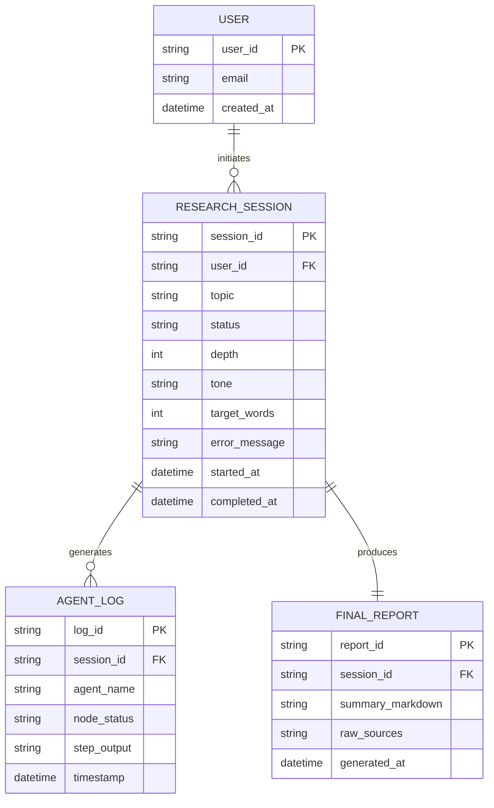

# Agentic Research & Summarizer Dashboard — Plan

## Summary

An autonomous research pipeline with a web dashboard. A user submits a topic plus
execution parameters (depth, tone, target length). A state graph runs two agents in
sequence: a **Researcher** that formulates search queries, calls a web search tool and
collects source material, and an **Editor** that checks the collected material for
relevance, synthesises it and formats a Markdown executive brief.

While the graph runs, the backend streams node-level status updates to the browser over
Server-Sent Events, so the UI shows *Researcher active → Editor active → Completed* in
real time. Every run is persisted: the session, each agent step, and the final report.
Past briefs are browsable from a history view.

The deliverable is a two-part application:

- `backend/` — FastAPI + LangGraph + SQLAlchemy (SQLite)
- `frontend/` — React + Vite single-page app

## Tech stack

### Backend

| Concern | Choice |
|---|---|
| API | FastAPI (async), Uvicorn |
| Agent orchestration | LangGraph `StateGraph` with a typed state dict |
| LLM access | `langchain-openai` (OpenAI-compatible endpoints), optional `langchain-google-genai` |
| Web search | Tavily REST API called directly with `httpx` (no extra SDK dependency) |
| Persistence | SQLAlchemy 2.0 async ORM over SQLite (`aiosqlite`) |
| Validation | Pydantic v2 / `pydantic-settings` |
| Streaming | `StreamingResponse` with `text/event-stream`, fed by an in-process event bus |
| Tests | `pytest`, `pytest-asyncio`, `httpx.ASGITransport` |

### Frontend

| Concern | Choice |
|---|---|
| Build | Vite |
| UI | React 18 + React Router |
| Data fetching | native `fetch` |
| Streaming | native `EventSource` |
| Markdown | `react-markdown` + `remark-gfm` |
| Styling | plain CSS with custom properties (no design system) |

## Architecture



### Run lifecycle



### Graph shape

`researcher` is a loop node. It runs once per round; after each round a conditional edge
decides whether to run another round (`round < depth` and the search tool is still
returning new material) or hand off to `editor`. `editor` runs once and ends the graph.



## Data model



Rules:

- `RESEARCH_SESSION.status` is one of `pending`, `running`, `completed`, `failed`.
- `AGENT_LOG` is append-only; it is the durable record behind the live stream, so a
  reloaded page can replay a finished run from the database.
- `FINAL_REPORT.raw_sources` holds a JSON array of `{title, url, snippet}` objects.
- Deleting a session cascades to its logs and report.
- `depth`, `tone` and `target_words` are stored on the session so a brief can be
  reproduced and so history rows show how the run was configured.

## Folder structure

```text
agentic-research/
├── PLAN.md
├── README.md
├── .env.example
├── .gitignore
├── backend/
│   ├── requirements.txt
│   ├── pytest.ini
│   ├── app/
│   │   ├── main.py                 FastAPI app, CORS, startup
│   │   ├── config.py               Settings from environment
│   │   ├── agents/
│   │   │   ├── state.py            Typed graph state
│   │   │   ├── graph.py            StateGraph wiring
│   │   │   ├── researcher.py       Researcher node
│   │   │   ├── editor.py           Editor node
│   │   │   ├── llm.py              Chat model factory + offline fallback
│   │   │   └── prompts.py          Prompt templates
│   │   ├── api/
│   │   │   ├── deps.py             DB session dependency
│   │   │   └── routes/
│   │   │       ├── health.py
│   │   │       ├── sessions.py     CRUD + history
│   │   │       └── stream.py       SSE endpoint
│   │   ├── db/
│   │   │   ├── base.py             Engine, session factory, init
│   │   │   └── models.py           ORM models
│   │   ├── repositories/
│   │   │   └── research.py         Data access helpers
│   │   ├── schemas/
│   │   │   └── research.py         Request/response models
│   │   └── services/
│   │       ├── events.py           Per-session event bus with replay
│   │       ├── search.py           Tavily + offline search providers
│   │       └── pipeline.py         Runs the graph, persists, emits
│   └── tests/
│       ├── conftest.py
│       ├── test_health.py
│       ├── test_sessions.py
│       └── test_pipeline.py
└── frontend/
    ├── package.json
    ├── vite.config.js
    ├── index.html
    └── src/
        ├── main.jsx
        ├── App.jsx
        ├── styles.css
        ├── api/client.js
        ├── components/
        │   ├── AgentTimeline.jsx
        │   ├── BriefView.jsx
        │   ├── Layout.jsx
        │   ├── ResearchForm.jsx
        │   └── StatusBadge.jsx
        └── pages/
            ├── BriefPage.jsx
            ├── HistoryPage.jsx
            └── ResearchPage.jsx
```

## Task list

1. Project scaffold, `.gitignore`, `.env.example`.
2. Backend settings module and SQLAlchemy models for the four tables.
3. Repository layer: create session, append log, save report, list/fetch/delete.
4. Event bus with per-session queues and replay buffer for late subscribers.
5. Search provider: Tavily over `httpx`, plus a deterministic offline provider.
6. LLM factory with OpenAI / Gemini / offline backends.
7. Researcher node: query formulation, search calls, note extraction, round loop.
8. Editor node: relevance filtering, synthesis, Markdown formatting.
9. Graph wiring with the conditional researcher→researcher / researcher→editor edge.
10. Pipeline service that runs the graph, writes logs and emits events.
11. REST routes: create/list/get/delete session, health.
12. SSE route with keep-alives and disconnect handling.
13. Backend tests covering health, session CRUD and an offline end-to-end run.
14. Frontend scaffold, router, API client, styles.
15. Research page: form, live agent timeline over `EventSource`, rendered brief.
16. History page and brief detail page.
17. README with setup, run and configuration steps.

## Assumptions

- **Project name.** The idea file is `projects/Agentic Research` — no number prefix and no
  `.md` extension. The folder and repository are named `agentic-research`, derived from the
  title in kebab-case.
- **Database.** The idea does not name a store beyond "local persistence store". SQLite via
  the async SQLAlchemy ORM is used, with a single `app.db` file. Timestamps are stored as
  naive UTC and serialised with a `Z` suffix. Moving to PostgreSQL is a connection-string
  change.
- **Authentication is out of scope.** The schema keeps the `USER` table from the idea, and
  the backend seeds exactly one local user (`local@example.com`) that owns every session.
  No login screen is built.
- **Search provider.** Tavily is used because it has a single-call REST endpoint that
  returns clean extracted content. Without `TAVILY_API_KEY` the app falls back to an
  offline provider that returns deterministic placeholder documents, so the whole pipeline
  is demonstrable without any credentials.
- **LLM provider.** Default is an OpenAI-compatible chat endpoint, configurable through
  `LLM_PROVIDER`, `LLM_MODEL` and `OPENAI_BASE_URL`, so a local server works too. Gemini is
  supported as an optional extra. With `LLM_PROVIDER=offline` the nodes produce a
  deterministic template brief from the collected documents instead of calling a model.
- **Streaming transport.** SSE rather than WebSockets: the stream is one-directional and
  SSE reconnects natively in the browser.
- **Event bus is in-process.** A single Uvicorn worker is assumed. Multi-worker deployment
  would need Redis pub/sub; it is noted in the README rather than built.
- **Depth semantics.** `depth` is the number of research rounds (1–4). Each round issues
  up to three search queries.
- **Tone and target length** are passed to the editor prompt and recorded on the session;
  they are advisory, not hard-enforced on the model output.
- **No execution or installation.** Per the workspace rules nothing was installed and no
  code was run, so the project ships unverified.
